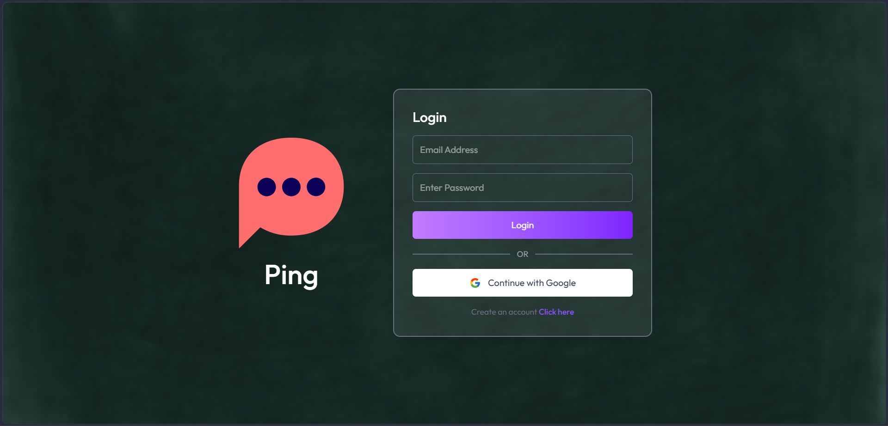
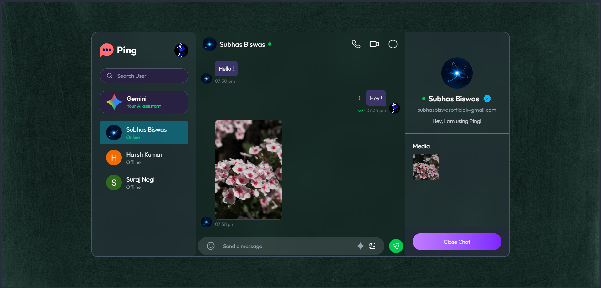
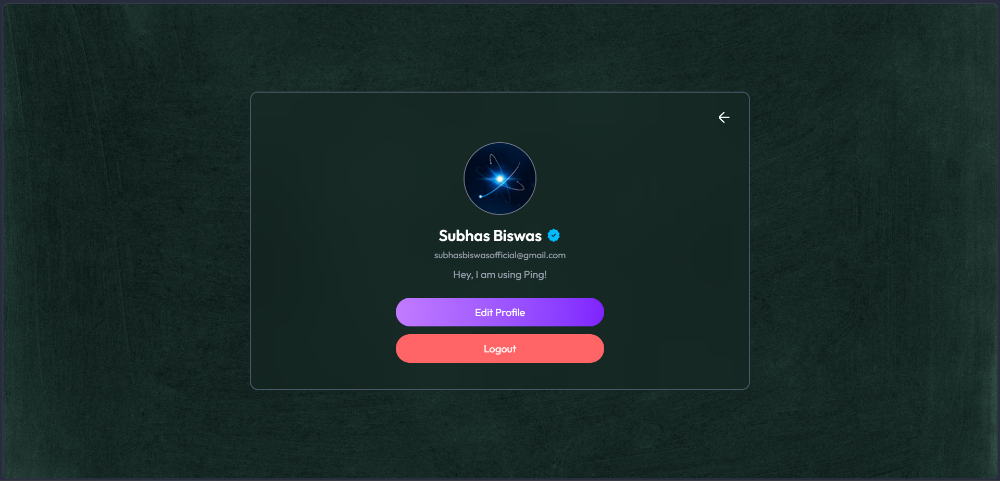
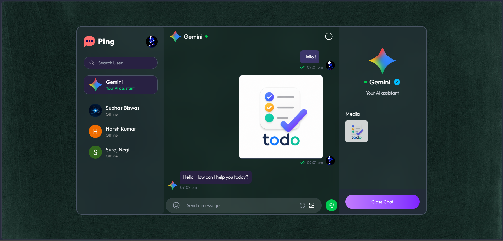

# Ping

**Ping** is a real-time chat application built with React, Node.js, Express, MongoDB, Socket.IO, and Google Gemini. It includes private messaging, online presence, typing indicators, read receipts, audio/video calling, Google sign-in, and Gemini-powered chat and automatic replies.

- **Live application:** https://ping-chat-omega.vercel.app
- **Backend:** https://ping-server-0q6n.onrender.com
- **Repository:** https://github.com/its-subhas/Ping-Chat

> This documentation is based on the source code in the supplied repository archive. The group-chat screens are currently a frontend demo using static data; the backend does not yet contain group-chat APIs or group persistence.

## Contents

- [Features](#features)
- [Screenshots](#Screenshots)
- [Technology stack](#technology-stack)
- [Repository structure](#repository-structure)
- [Architecture](#architecture)
- [Getting started](#getting-started)
- [Environment variables](#environment-variables)
- [API reference](#api-reference)
- [Real-time events](#real-time-events)
- [Authentication and security](#authentication-and-security)
- [Deployment](#deployment)
- [Implementation notes](#implementation-notes)
- [License](#license)

## Features

### Private messaging
- Send and receive text messages in real time.
- Share images; uploaded chat images are stored through Cloudinary.
- See online users and live typing indicators.
- Track unread messages.
- Mark received messages as seen and update the sender's read status in real time.
- Delete a message you sent; the deletion is synchronized with the recipient.
- View user profiles and update profile details and profile pictures.

### Authentication
- Email and password registration and login.
- Google OAuth sign-in and registration.
- Password hashing with bcrypt.
- Short-lived access tokens and refresh-token-based sessions.
- HTTP-only authentication cookies and server-side session revocation.

### Calls
- Audio and video calling using WebRTC.
- Socket.IO signaling for offers, answers, ICE candidates, call acceptance/rejection, call termination, and camera status.
- In-call controls in the client interface.

### Gemini features
- **Gemini Assistant Chat:** a separate assistant conversation that accepts text, conversation history, and supported image inputs.
- **AI Auto-Reply:** an account-level setting that allows Gemini to draft and send conversational replies to incoming private messages. The server queues messages, shows an AI typing indicator, considers recent text/image context, and limits an AI-to-AI reply chain to five generated replies.

### Group interface
- The repository includes group-oriented screens and sample group/message data on the frontend.
- Group creation, group messages, group membership, and group persistence are not implemented in the supplied backend source. The current group screens should therefore be considered a UI/demo feature, not a completed server-backed group chat.

## Technology stack

| Area | Technologies |
|---|---|
| Frontend | React 19, Vite 8, Tailwind CSS 4 |
| Routing and state | React Router 7, Redux Toolkit, React Redux |
| HTTP and notifications | Axios, React Hot Toast |
| Real-time client | Socket.IO Client |
| Backend | Node.js, Express 5 |
| Database | MongoDB, Mongoose |
| Authentication | JSON Web Token, bcryptjs, HTTP-only cookies, Google Auth Library |
| File and image hosting | Cloudinary |
| AI | Google Gemini via `@google/genai` |
| Calling | WebRTC and Socket.IO signaling |
| Deployment configuration | Vercel rewrites; backend can run on a Node hosting provider |

## Screenshots

### Login


### Main Chat


### Profile


### Gemini Assistant


### Audio / Video Call


## Repository structure

```text
Ping-Chat/
├── README.md
└── Ping Chat/
    ├── Ping-Client/
    │   ├── public/
    │   ├── src/
    │   │   ├── assets/
    │   │   ├── components/
    │   │   ├── lib/
    │   │   ├── pages/
    │   │   ├── store/
    │   │   ├── App.jsx
    │   │   ├── index.css
    │   │   └── main.jsx
    │   ├── package.json
    │   ├── vite.config.js
    │   └── vercel.json
    └── Ping-Server/
        ├── controllers/
        ├── lib/
        ├── middleware/
        ├── models/
        ├── public/
        ├── routes/
        ├── package.json
        └── server.js
```

### Main backend modules

- `controllers/userController.js` — signup, login, Google callback, token refresh, profile updates, logout, and AI Auto-Reply setting.
- `controllers/messageController.js` — private messages, read receipts, message deletion, and the AI Auto-Reply queue.
- `controllers/geminiController.js` — Gemini Assistant and AI Auto-Reply generation.
- `routes/userRoutes.js` and `routes/messageRoutes.js` — HTTP route definitions.
- `middleware/auth.js` — access-token and active-session verification.
- `middleware/validator.js` — signup, login, and profile input validation.
- `models/User.js`, `models/Message.js`, and `models/Session.js` — MongoDB models.
- `lib/calls.js` — Socket.IO call signaling.
- `lib/cloudinary.js` — Cloudinary configuration.

## Architecture

1. The React client renders the chat interface and stores application/auth state with Redux Toolkit.
2. HTTP requests use Axios with credentials enabled. The frontend sends the in-memory access token as a Bearer token when available.
3. Express validates protected requests with the access token and checks the associated active session in MongoDB.
4. MongoDB stores users, private messages, and sessions.
5. Socket.IO sends live private-message, online-presence, typing, read-receipt, and call-signaling updates.
6. Cloudinary stores profile and chat images.
7. The backend calls Gemini for assistant responses and optional automatic replies.

## Getting started

### Prerequisites

- Node.js (use a current LTS release).
- npm.
- A MongoDB database.
- Cloudinary credentials for image uploads.
- Google Gemini API key for Gemini features.
- Google OAuth credentials if Google sign-in is enabled.

### 1. Clone the repository

```bash
git clone https://github.com/its-subhas/Ping-Chat.git
cd Ping-Chat
```

### 2. Configure and start the backend

```bash
cd "Ping Chat/Ping-Server"
npm install
```

Create a `.env` file in `Ping-Server/` using the backend variables in [Environment variables](#environment-variables).

Start the development server:

```bash
npm run dev
```

The backend uses `PORT` when supplied and otherwise listens on port `3000`. Its root page and `/api/status` endpoint provide basic server status.

### 3. Configure and start the frontend

Open a second terminal:

```bash
cd "Ping Chat/Ping-Client"
npm install
```

Create `.env` in `Ping-Client/` and set `VITE_BACKEND_URL` to the backend origin. Start Vite:

```bash
npm run dev
```

The Vite configuration in this repository does not define an `/api` development proxy. The frontend's Axios client calls same-origin `/api/...` paths, while the included Vercel rewrite handles those paths in the deployed app. For local development, configure a Vite `/api` proxy to your backend or use a local setup that applies the same rewrite. `VITE_BACKEND_URL` is used by the Socket.IO client; it does not set Axios's HTTP base URL in the supplied code.

## Environment variables

Do not commit `.env` files or secret values.

### Frontend — `Ping Chat/Ping-Client/.env`

| Variable | Required | Description |
|---|---:|---|
| `VITE_BACKEND_URL` | Yes | Backend origin used by the Socket.IO client, e.g. `http://localhost:3000` locally or your deployed backend origin. |

### Backend — `Ping Chat/Ping-Server/.env`

| Variable | Required | Description |
|---|---:|---|
| `PORT` | No | HTTP server port; defaults to `3000`. |
| `NODE_ENV` | Yes for production behavior | Set to `production` in production so cookies use `Secure` and `SameSite=None`; use `development` locally. |
| `CLIENT_URL` | Yes | Frontend origin allowed by Express/Socket.IO CORS and used after Google OAuth, e.g. `http://localhost:5173` or the deployed frontend origin. |
| `MONGODB_URI` | Yes | MongoDB connection URI. The backend appends `/Ping` as the database name. |
| `JWT_SECRET_ACCESS_TOKEN` | Yes | Secret used to sign and verify access tokens. |
| `JWT_SECRET_REFRESH_TOKEN` | Yes | Separate secret used to sign and verify refresh tokens. |
| `CLOUDINARY_CLOUD_NAME` | Yes for image uploads | Cloudinary cloud name. |
| `CLOUDINARY_API_KEY` | Yes for image uploads | Cloudinary API key. |
| `CLOUDINARY_API_SECRET` | Yes for image uploads | Cloudinary API secret. |
| `GEMINI_API_KEY` | Yes for Gemini features | Google Gemini API key. |
| `GOOGLE_CLIENT_ID` | Yes for Google OAuth | Google OAuth client ID. |
| `GOOGLE_CLIENT_SECRET` | Yes for Google OAuth | Google OAuth client secret. |
| `GOOGLE_REDIRECT_URI` | Yes for Google OAuth | Exact backend callback URL: `https://YOUR_BACKEND_HOST/api/auth/google/callback` (or the corresponding local URL). |

Configure the same exact `GOOGLE_REDIRECT_URI` in the Google Cloud OAuth client’s authorized redirect URIs. Set `CLIENT_URL` to the frontend origin, not the callback URL.

## API reference

All application API routes are mounted under `/api`. Protected routes require a valid access token and an active session. The client also sends HTTP-only cookies with requests.

### Status

| Method | Endpoint | Access | Purpose |
|---|---|---|---|
| `GET` | `/` | Public | Backend status page. |
| `GET` | `/api/status` | Public | JSON status response. |

### Authentication — `/api/auth`

| Method | Endpoint | Access | Purpose |
|---|---|---|---|
| `POST` | `/signup` | Public | Create an account. |
| `POST` | `/login` | Public | Authenticate with email and password. |
| `POST` | `/refresh` | Refresh cookie | Refresh/rotate the access token using the refresh session. |
| `GET` | `/check` | Protected | Return the authenticated user. |
| `PUT` | `/update-profile` | Protected | Update profile name, bio, and optional image. |
| `PUT` | `/ai-auto-reply` | Protected | Enable or disable the account's AI Auto-Reply setting. |
| `POST` | `/logout` | Cookie/session | Revoke the current session and clear auth cookies. |
| `GET` | `/google` | Public | Start Google OAuth. |
| `GET` | `/google/callback` | Google OAuth callback | Verify Google identity and create a session. |

Signup body:

```json
{
  "fullName": "Your Name",
  "email": "you@example.com",
  "password": "StrongPassword1!",
  "bio": "Hello, I am using Ping!"
}
```

Login body:

```json
{
  "email": "you@example.com",
  "password": "StrongPassword1!"
}
```

Profile update body accepts `fullName`, `bio`, and optional base64 data-URL `profilePic` (JPG/JPEG/PNG). AI Auto-Reply body:

```json
{
  "aiAutoReply": true
}
```

### Messages — `/api/messages`

| Method | Endpoint | Access | Purpose |
|---|---|---|---|
| `GET` | `/users` | Protected | List other users and unread-message counts. |
| `GET` | `/:id` | Protected | Get the private conversation with the specified user; also marks incoming unread messages as seen. |
| `PUT` | `/mark/:id` | Protected | Mark a message as seen. |
| `POST` | `/send/:id` | Protected | Send a text message and/or image to the specified user. |
| `DELETE` | `/delete/:messageId` | Protected | Delete a message sent by the authenticated user. |
| `POST` | `/gemini` | Protected | Generate a Gemini Assistant response. |

Send-message body accepts `text` and optional base64 image data in `image`. The delete-message body requires `receiverUserId`.

Gemini request body:

```json
{
  "message": "Explain this concept",
  "history": [],
  "images": []
}
```

The `images` array accepts objects containing `mimeType` (`image/jpeg`, `image/png`, or `image/webp`) and base64 `data`. A message or at least one image is required.

## Real-time events

### Presence and messaging

| Event | Direction | Purpose |
|---|---|---|
| `getOnlineUsers` | Server → clients | Broadcast connected user IDs. |
| `userTyping` | Client → server | Notify a recipient that the sender is typing. |
| `userStopTyping` | Client → server | Notify a recipient that typing stopped. |
| `isTyping` | Server → client | Deliver typing state. |
| `newMessage` | Server → clients | Deliver a new private message, including generated AI replies. |
| `messageDeleted` | Server → recipient | Notify the recipient that a message was deleted. |
| `messageSeen` | Server → sender | Update the sender's read/seen state. |

### Calls and WebRTC signaling

| Event | Purpose |
|---|---|
| `audioCallOffer`, `videoCallOffer` | Start an incoming audio/video call notification. |
| `incomingAudioCall`, `incomingVideoCall` | Notify the called user. |
| `acceptIncomingCalls`, `rejectIncomingCalls` | Accept or reject a call. |
| `acceptCalls`, `rejectCalls` | Notify the other caller. |
| `endOutgoingCalls`, `endCalls` | End an unanswered call. |
| `endConnectedCalls`, `connectedEnds` | End an active call. |
| `readyForWebRTC` | Coordinate WebRTC setup. |
| `webrtcOffer`, `webrtcAnswer` | Exchange session descriptions. |
| `iceCandidate` | Exchange ICE candidates. |
| `cameraStatus` | Share camera-off status. |

## Authentication and security

- Passwords are hashed with bcrypt before being stored.
- Access and refresh tokens use separate JWT secrets.
- Access tokens are short-lived (15 minutes); refresh sessions are created with a 15-day expiry.
- Refresh-token values are stored as bcrypt hashes in session records.
- Session records support revocation and have a TTL index on `expiresAt`.
- Authentication cookies are HTTP-only. In production, the source configures them with `Secure` and `SameSite=None`; locally it uses non-secure cookies and `SameSite=Lax`.
- Protected HTTP endpoints verify the access token and check that its session exists, is not revoked, and has not expired.
- Signup, login, and profile input have server-side validation.

**Deployment note:** the current Socket.IO connection identifies a user using the `userId` handshake query parameter. The supplied server code does not authenticate that socket handshake with the HTTP session. Review and secure socket identity before treating the real-time layer as production-hardened.

## Deployment

### Frontend on Vercel

1. Import the repository into Vercel.
2. Set the project Root Directory to `Ping Chat/Ping-Client`.
3. Use the Vite build command `npm run build` and output directory `dist`.
4. Add `VITE_BACKEND_URL` with the backend origin.
5. Ensure `vercel.json` points `/api/*` requests to the correct backend. The included file currently rewrites them to `https://ping-server-0q6n.onrender.com/api/$1`.

### Backend on Render or another Node host

1. Create a Node web service connected to the repository.
2. Set the Root Directory to `Ping Chat/Ping-Server`.
3. Build/install command: `npm install`.
4. Start command: `npm start`.
5. Add all required backend environment variables.
6. Set `CLIENT_URL` to the deployed frontend origin.
7. Set `GOOGLE_REDIRECT_URI` to the deployed backend's `/api/auth/google/callback` URL and register that exact URL in Google Cloud Console.
8. Set `NODE_ENV=production`.

The backend listens on `process.env.PORT` or port `3000` and binds to `0.0.0.0`.

## Implementation notes

- The group pages currently use static arrays in the frontend assets and local component state. No group models, group controllers, or group API routes are present in this backend archive.
- WebRTC uses Google's public STUN server (`stun:stun.l.google.com:19302`). No TURN server is configured in the supplied client source. Some networks may therefore prevent calls from connecting; production deployments commonly need TURN infrastructure.
- The supplied Vite config does not include a development API proxy. Production API forwarding is handled by `vercel.json`.
- The repository archive does not include `.env` files or screenshot assets. Add screenshots manually if you want them displayed in this README.
- There is no root `LICENSE` file in the supplied archive. The backend `package.json` declares `ISC`, but that alone does not establish a repository-wide license. Add a root license file if you intend to publish explicit reuse terms.

## License

No root project license file was included in the supplied repository archive. Check with the project owner before reusing, modifying, or distributing this project.
