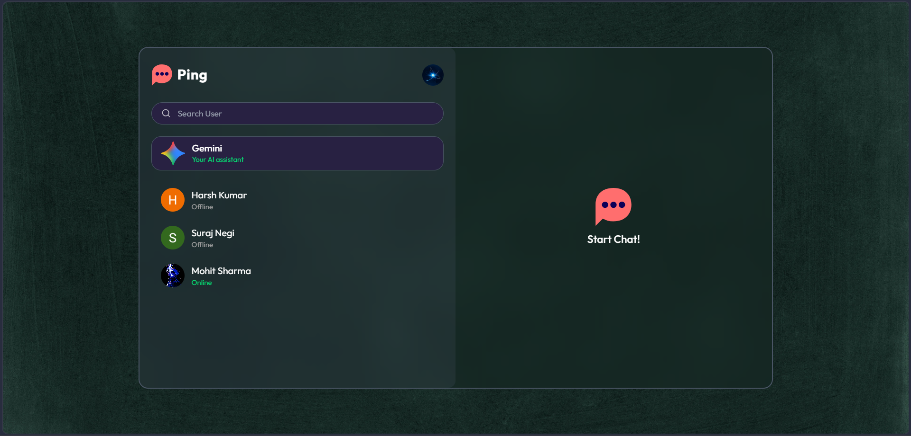
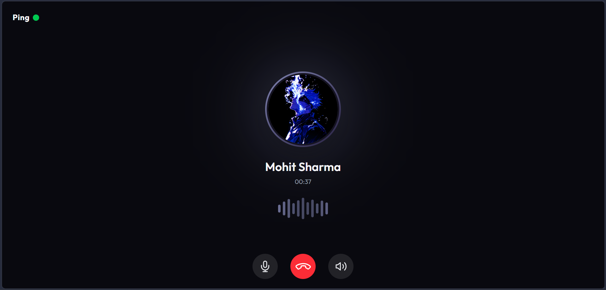

# Ping

**Ping** is a real-time chat application built with React, Node.js, Express, MongoDB, Socket.IO, WebRTC, and Google Gemini. It includes private messaging, online presence, typing indicators, read receipts, audio/video calling, Google sign-in, and Gemini-powered chat and automatic replies.

- **Live Application:** https://ping-chat-omega.vercel.app
- **Backend:** https://ping-server-0q6n.onrender.com
- **GitHub Repository:** https://github.com/its-subhas/Ping-Chat

## Table of Contents

- [Features](#features)
- [Screenshots](#screenshots)
- [Technology Stack](#technology-stack)
- [Repository Structure](#repository-structure)
- [Architecture](#architecture)
- [Getting Started](#getting-started)
- [Environment Variables](#environment-variables)
- [API Reference](#api-reference)
- [Real-Time Communication](#real-time-communication)
- [Authentication and Security](#authentication-and-security)
- [Deployment](#deployment)
- [Implementation Notes](#implementation-notes)
- [License](#license)

## Features

### Authentication

- User registration and login
- Google OAuth authentication
- Password hashing with bcrypt
- JWT access and refresh token authentication
- HTTP-only authentication cookies
- Session management and revocation
- Automatic access token refresh

### Private Messaging

- Real-time private messaging
- Send and receive text messages
- Share images
- Online and offline user presence
- Real-time typing indicators
- Message seen/read status
- Unread message counts
- Delete messages
- User profile information

### Audio and Video Calling

- Real-time audio calls
- Video calls
- Incoming call notifications
- Accept and reject calls
- Microphone mute controls
- Camera on/off controls
- WebRTC-based peer-to-peer communication
- Socket.IO-based call signaling

### Gemini AI Integration

- Gemini Assistant Chat
- AI-powered automatic replies
- Context-aware AI conversations
- Image-aware assistant interactions
- AI typing indicators
- Separate Assistant Chat and Auto-Reply functionality

### Profile Management

- Update profile information
- Change profile picture
- Edit biography
- Cloudinary image storage

### Group Chat Status

> **Group Chat:** Group chat functionality is currently hidden from the home screen and is not available in the user interface. Group messaging is not implemented in the backend.

## Screenshots

### Home



### Login


### Main Chat


### Profile


### Gemini Assistant


### Audio Call



### Video Call


## Technology Stack

### Frontend

| Technology | Purpose |
|---|---|
| React | User interface |
| Vite | Development and build tool |
| Tailwind CSS | Styling |
| Redux Toolkit | State management |
| React Router | Client-side routing |
| Axios | HTTP requests |
| Socket.IO Client | Real-time communication |
| WebRTC | Audio/video communication |
| React Hot Toast | Notifications |

### Backend

| Technology | Purpose |
|---|---|
| Node.js | JavaScript runtime |
| Express.js | Backend framework |
| MongoDB | Database |
| Mongoose | Database modeling |
| Socket.IO | Real-time communication |
| JSON Web Token | Authentication |
| bcryptjs | Password hashing |
| Cookie Parser | Cookie handling |
| Cloudinary | Image storage |
| Google Auth Library | Google OAuth |
| Google Gemini | AI integration |

### Deployment and Services

- **Frontend:** Vercel
- **Backend:** Render
- **Database:** MongoDB
- **Image Storage:** Cloudinary
- **AI:** Google Gemini

## Repository Structure

```text
Ping-Chat/
├── README.md
├── Screenshots/
│   ├── Audio-Call.png
│   ├── Chat.png
│   ├── Gemini.png
│   ├── Home.png
│   ├── Login.png
│   ├── Profile.png
│   └── Video-Call.png
└── Ping Chat/
    ├── Ping-Client/
    │   ├── public/
    │   ├── src/
    │   ├── package.json
    │   └── README.md
    └── Ping-Server/
        ├── config/
        ├── controllers/
        ├── middleware/
        ├── models/
        ├── routes/
        ├── lib/
        ├── package.json
        └── README.md
```

## Architecture

Ping uses a client-server architecture.

1. **Frontend:** React renders the application and manages UI state using Redux Toolkit.
2. **HTTP Communication:** Axios communicates with Express API endpoints.
3. **Authentication:** JWT access and refresh tokens manage authenticated sessions.
4. **Database:** MongoDB stores user information, messages, and session data.
5. **Real-Time Communication:** Socket.IO handles online presence, messaging events, typing indicators, and call signaling.
6. **Media Storage:** Cloudinary stores uploaded profile pictures and message images.
7. **AI Integration:** Google Gemini powers Assistant Chat and automatic replies.
8. **Audio/Video:** WebRTC provides peer-to-peer audio and video communication.

## Getting Started

### Prerequisites

Install the following before running the project:

- Node.js and npm
- MongoDB database
- Cloudinary account
- Google Gemini API key
- Google Cloud OAuth credentials (for Google sign-in)

### 1. Clone the repository

```bash
git clone https://github.com/its-subhas/Ping-Chat.git
cd Ping-Chat
```

### 2. Set up the backend

```bash
cd "Ping Chat/Ping-Server"
npm install
```

Create a `.env` file and configure the backend environment variables described below.

Start the backend:

```bash
npm run dev
```

### 3. Set up the frontend

Open another terminal:

```bash
cd "Ping-Chat/Ping Chat/Ping-Client"
npm install
```

Create a `.env` file:

```env
VITE_BACKEND_URL=http://localhost:7000
```

Start the frontend:

```bash
npm run dev
```

The frontend normally runs at `http://localhost:5173`, and the backend runs at `http://localhost:7000`.

## Environment Variables

### Frontend – Ping-Client

Create `.env` inside `Ping-Client`:

```env
VITE_BACKEND_URL=http://localhost:7000
```

| Variable | Description |
|---|---|
| `VITE_BACKEND_URL` | Backend URL used for Socket.IO connections |

### Backend – Ping-Server

Create `.env` inside `Ping-Server`:

```env
PORT=7000
NODE_ENV=development
CLIENT_URL=http://localhost:5173

MONGODB_URI=your_mongodb_connection_string

JWT_SECRET_ACCESS_TOKEN=your_access_token_secret
JWT_SECRET_REFRESH_TOKEN=your_refresh_token_secret

CLOUDINARY_CLOUD_NAME=your_cloudinary_cloud_name
CLOUDINARY_API_KEY=your_cloudinary_api_key
CLOUDINARY_API_SECRET=your_cloudinary_api_secret

GEMINI_API_KEY=your_gemini_api_key

GOOGLE_CLIENT_ID=your_google_client_id
GOOGLE_CLIENT_SECRET=your_google_client_secret
GOOGLE_REDIRECT_URI=http://localhost:7000/api/auth/google/callback
```

| Variable | Description |
|---|---|
| `PORT` | Backend server port |
| `NODE_ENV` | Application environment |
| `CLIENT_URL` | Frontend origin allowed by CORS |
| `MONGODB_URI` | MongoDB connection string |
| `JWT_SECRET_ACCESS_TOKEN` | Access token signing secret |
| `JWT_SECRET_REFRESH_TOKEN` | Refresh token signing secret |
| `CLOUDINARY_CLOUD_NAME` | Cloudinary cloud name |
| `CLOUDINARY_API_KEY` | Cloudinary API key |
| `CLOUDINARY_API_SECRET` | Cloudinary API secret |
| `GEMINI_API_KEY` | Google Gemini API key |
| `GOOGLE_CLIENT_ID` | Google OAuth client ID |
| `GOOGLE_CLIENT_SECRET` | Google OAuth client secret |
| `GOOGLE_REDIRECT_URI` | Google OAuth callback URL |

**Important:**
- Replace all placeholder values with your actual credentials.
- The application uses the `Ping` MongoDB database; configure the connection string according to your database setup.
- Never commit `.env` files or expose private credentials.
- Configure the Google OAuth redirect URI to exactly match the URL registered in Google Cloud Console.

## API Reference

The backend exposes the following API routes.

### Authentication

Base route: `/api/auth`

| Method | Endpoint | Description |
|---|---|---|
| POST | `/signup` | Register a new user |
| POST | `/login` | Authenticate a user |
| POST | `/refresh` | Refresh access token |
| GET | `/check` | Check authentication |
| PUT | `/update-profile` | Update user profile |
| PUT | `/ai-auto-reply` | Update AI Auto-Reply setting |
| POST | `/logout` | Logout and revoke session |
| GET | `/google` | Start Google OAuth |
| GET | `/google/callback` | Handle Google OAuth callback |

### Messages

Base route: `/api/messages`

| Method | Endpoint | Description |
|---|---|---|
| GET | `/users` | Retrieve users |
| GET | `/:id` | Retrieve conversation messages |
| PUT | `/mark/:id` | Mark messages as seen |
| POST | `/send/:id` | Send a message |
| DELETE | `/delete/:messageId` | Delete a message |
| POST | `/gemini` | Gemini Assistant Chat |

### Status

| Method | Endpoint | Description |
|---|---|---|
| GET | `/` | Root endpoint |
| GET | `/api/status` | Backend status |

## Real-Time Communication

Socket.IO handles real-time communication between connected users.

### Messaging and Presence

| Event | Description |
|---|---|
| `getOnlineUsers` | Update online users |
| `userTyping` | Notify when a user starts typing |
| `userStopTyping` | Notify when a user stops typing |
| `isTyping` | Receive typing status |
| `newMessage` | Receive a new message |
| `messageDeleted` | Notify message deletion |
| `messageSeen` | Notify message seen status |

### Audio and Video Calls

The call signaling implementation handles:

- Audio and video call offers
- Incoming call notifications
- Accepting and rejecting calls
- Ending calls
- WebRTC offer and answer exchange
- ICE candidate exchange
- Camera status updates

## Authentication and Security

- Passwords are hashed using bcrypt.
- Access and refresh tokens use separate signing secrets.
- Access tokens have a 15-minute lifetime.
- Refresh sessions are configured for up to 15 days.
- Refresh tokens are stored as hashes in the session database.
- Protected routes validate the access token and active session.
- Logout revokes the active session.
- HTTP-only cookies are used for authentication tokens.
- CORS is configured to allow the frontend origin with credentials.

**Socket.IO note:** The current socket connection identifies users through a `userId` handshake query parameter. This is separate from the HTTP protected-route authentication flow.

## Deployment

### Frontend – Vercel

1. Import the GitHub repository into Vercel.
2. Set the root directory to `Ping Chat/Ping-Client`.
3. Configure `VITE_BACKEND_URL` with your deployed backend URL.
4. Build the project using `npm run build`.
5. Deploy the frontend.

The production API rewrite must point to your deployed backend.

### Backend – Render

1. Create a new Web Service on Render.
2. Connect the GitHub repository.
3. Set the root directory to `Ping Chat/Ping-Server`.
4. Configure the build command as `npm install`.
5. Configure the start command according to the backend `package.json`.
6. Add all required backend environment variables.
7. Deploy the service.

### Google OAuth Configuration

For production, register this callback URL in Google Cloud Console:

```text
https://ping-server-0q6n.onrender.com/api/auth/google/callback
```

For local development:

```text
http://localhost:7000/api/auth/google/callback
```

The registered redirect URI and `GOOGLE_REDIRECT_URI` must match exactly.

## Implementation Notes

- Group Chat is currently hidden from the home screen and unavailable in the user interface.
- Group messaging, group database models, and backend group APIs are not implemented.
- Gemini Assistant Chat and AI Auto-Reply are separate features.
- WebRTC currently uses Google's public STUN server. No TURN server is configured, so calls may not connect on some restrictive networks.
- The frontend uses `/api` for Axios requests, with a production Vercel rewrite to the backend. Configure a development API proxy if you want local Axios requests to reach the local backend.
- `VITE_BACKEND_URL` is used for the frontend Socket.IO connection.
- Environment files are not included in the repository. Create your own using the examples above.

## License

No root-level project license is currently provided. Check the repository for an explicit license before reusing, modifying, or distributing this project.
